# ESP32 Fan Controller

This project can control up to six 6-8 fans via ESPhome and Home Assistant  
If no Home Assistant is used, a web_server needs to be declared in ESPhome configuration

## Features

- 3 connectors for external DS18B20+ temperature sensors
- 1 connector for an I2C temperature sensors
- included Power State/Switch via MOCD207R2M optocoupler (Reads computer state and can turn power on/off)

## Schematic

## Components used in this project:

| Reference | Component |
|:---|:---|
| U1 | ESP32 DevKit V1 |
| U2 U3 | SN74AHCT125DR Quadruple Bus Buffer |
| U4 | MOCD207R2M 2ch Optocoupler |
| C1 C2 C4 |  MLCC 1206 0.1uf 25V |
| C3 C5 | MLCC 1206 10uF 25V |
| F1 | 0ZCH0075FF2G PTC 8V 750mA |
| LED1 | OSY51206C1E 1206 Yellow LED |
| LED2 | OSG51206C1E 1206 Green LED |
| LED3 | OSR51206C1E 1206 Red LED |
| R3 R7 R11 R13 R15 R17 |  33R 0.25W 1206 |
| R1 R2 R8 R9 R10 R12 R14 | 4.7k 0.25W 1206 |
| R5 R6 | 1k 0.25W 1206 |
| R18 R19 | 2k2 0.25W 1206 |
| R4 | 10k 0.25W 1206 |
| J1 J2 | JST S4B-EH / EHR-4 / SEH-001T-P0.6 |
| J3 J4 J5 J6 J8 J9 | KF2510 3+1P KK254 Style |
| J7 |  2.54mm 2x4 male pin header |
| J10 |  2.54mm 1x4 male pin header |
| J14 J15 J16 | 2.54mm 1x3 male pin header |
| J11 J12 J13 | DS1031-01-1*10P8BV31-3A 1.27mm 1x10 male pin header (+plus jumpers) |

